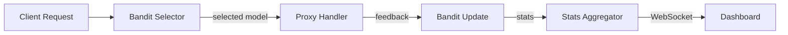

# OmniRoute Bandit Proxy

**Multi-Armed Bandit reverse proxy for LLM traffic**

[](https://opensource.org/licenses/MIT)
[](https://nodejs.org/)
[](https://github.com/CherrugDeveloper/omniroute-bandit-proxy/actions)
[](https://github.com/CherrugDeveloper/omniroute-bandit-proxy/releases/tag/v0.50.0)

## Overview

The OmniRoute Bandit Proxy is a Node.js-based reverse proxy that implements a discounted Upper Confidence Bound (UCB1) bandit algorithm for routing LLM traffic to available models. It dynamically selects models based on their performance history, applying exponential backoff cooldowns and a 5-strike punishment system for error handling.

Core features include:
- Dynamic model selection using Discounted UCB1 algorithm
- 5-strike punishment system (consecutive critical failures → permanent ban)
- Exponential backoff cooldowns: 15s → 5m → 30m → 2h → permanent
- Cascade ban guards for paid group bans
- Real-time punishment event tracking via WebSocket
- Profile bias multipliers for model selection
- Session management with 30m TTL and 60s stream idle timeout

## Core Concepts

### Bandit Algorithm

The proxy uses a **Discounted UCB1 bandit algorithm** with a 0.99 discount factor per event. This means older feedback is weighted less than newer feedback, allowing the system to adapt to changing model performance. The algorithm maintains a rank cache with a 30-second TTL for efficient model selection.

### Error Classification

Errors are classified as either **transient** (temporary cooldowns) or **permanent** (model bans):

- **Transient errors** (cooldown-model, cooldown-provider): Timeout errors, safeWrite errors, 5xx errors (≥3 triggers degraded mode)
- **Permanent errors** (ban-model, ban-provider): 403, 429 consecutive critical failures → after 5 strikes, permanent ban

The `_sanitizeModelId()` function strips duplicated provider prefixes (e.g., `mistral/mistral-x` → `mistral-x`) only if the sanitized ID exists in the catalog.

### Punishment System

- **5-strike system**: 5 consecutive critical failures (403, 429) → permanent ban. Counter resets on success.
- **Exponential backoff cooldowns**: 15s → 5m → 30m → 2h → permanent
- **Cascade ban guard**: Paid group ban UPDATE includes `AND permanent = 0`
- **Emergency rejection countermeasure**: Downgraded from ban-model to cooldown-model (300000ms)

The dashboard now prioritizes bandit system flags over quota exhaustion for model state display:

| Priority | State | Description |
|----------|-------|-------------|
| 1 | **banned** | Model has `permanent = 1` flag |
| 2 | **needs-attention** | Model has `needs_attention = 1` flag |
| 3 | **cooldown** | Model has `cooldown_until > 0` |
| 4 | **quota-exhausted** | Free or paid quota has been exhausted (≥80% usage) |
| 5 | **active** | Model is available for selection |

### 5-Strike Rule

| Strike # | Condition | Action | Cooldown |
|----------|-----------|--------|----------|
| 1 | 1st critical failure (403, 429) | Start tracking | - |
| 2 | 2nd consecutive critical failure | Continue tracking | - |
| 3 | 3rd consecutive critical failure | Escalate cooldown | - |
| 4 | 4th consecutive critical failure | Extend cooldown | - |
| 5 | 5th consecutive critical failure | **Permanent ban** | Permanent |

**Counter resets on success** (any successful request clears the strike counter).

Timeout errors are transient (cooldown-model), NOT critical — they never count toward the 5-strike permanent ban.

safeWrite errors are cooldown-model (transient), NOT critical — they never count toward strikes.

### Exponential Backoff Cooldowns

| Stage | Duration | Description |
|-------|----------|-------------|
| 1 | 15s | Initial cooldown after first critical failure |
| 2 | 5m | Extended cooldown after second consecutive failure |
| 3 | 30m | Moderate cooldown after third consecutive failure |
| 4 | 2h | Significant cooldown after fourth consecutive failure |
| 5 | permanent | Permanent ban after fifth consecutive failure |

Cooldown progression resets if a successful request occurs before the full sequence is completed.

### Cascade Guards

- Paid group ban UPDATE includes `AND permanent = 0` condition
- Emergency rejection countermeasure downgraded from `ban-model` to `cooldown-model` (300000ms)
- Model rehabilitation: `_checkRehabilitation()` auto-rehabilitates permanent bans after the rehab period

## Features

- Discounted UCB1 bandit algorithm with 0.99 discount factor
- 5-strike punishment system with exponential backoff
- Model availability checking via `bandit.isModelAvailable()`
- Fallback chain that bypasses UCB1 entirely
- Profile bias multipliers that stack
- Session affinity with re-validation before routing
- Emergency relaxation with 3 & 4 pre-check model availability
- WebSocket real-time updates for dashboard
- StatsAggregator singleton for real-time punishment stats
- Provider quota management with background roller

## Architecture

The system follows a modular architecture:

1. **Bandit Engine** (`src/bandit.mjs`): Core algorithm for model selection
2. **Proxy** (`src/index.mjs`): Express-based HTTP server handling LLM traffic
3. **Stats Aggregator** (`src/stats-aggregator.mjs`): Real-time punishment event statistics
4. **Provider Quota** (`src/provider-quota.mjs`): Quota management with background roller
5. **Structured Logger** (`src/structured-logger.mjs`): JSON-structured logging with ring buffer
6. **Event System** (`src/events.mjs`): WebSocket event broadcasting

Data flow:


## WebSocket Events

- `punishment_events`: Real-time punishment event stream
- Model availability updates
- Cooldown timer broadcasts
- Dashboard metric refreshes (2.5s auto-refresh)

## 5-Strike Rule

| Strike # | Condition | Action | Cooldown |
|----------|-----------|--------|----------|
| 1 | 1st critical failure (403, 429) | Start tracking | - |
| 2 | 2nd consecutive critical failure | Continue tracking | - |
| 3 | 3rd consecutive critical failure | Escalate cooldown | - |
| 4 | 4th consecutive critical failure | Extend cooldown | - |
| 5 | 5th consecutive critical failure | **Permanent ban** | Permanent |

**Counter resets on success** (any successful request clears the strike counter).

Timeout errors are transient (cooldown-model), NOT critical — they never count toward the 5-strike permanent ban.

safeWrite errors are cooldown-model (transient), NOT critical — they never count toward strikes.

### Exponential Backoff Cooldowns

| Stage | Duration | Description |
|-------|----------|-------------|
| 1 | 15s | Initial cooldown after first critical failure |
| 2 | 5m | Extended cooldown after second consecutive failure |
| 3 | 30m | Moderate cooldown after third consecutive failure |
| 4 | 2h | Significant cooldown after fourth consecutive failure |
| 5 | permanent | Permanent ban after fifth consecutive failure |

Cooldown progression resets if a successful request occurs before the full sequence is completed.

### Cascade Guards

- Paid group ban UPDATE includes `AND permanent = 0` condition
- Emergency rejection countermeasure downgraded from `ban-model` to `cooldown-model` (300000ms)
- Model rehabilitation: `_checkRehabilitation()` auto-rehabilitates permanent bans after the rehab period

## Error Classification

| Pattern | Classification | Scope | Critical? |
|---------|---------------|-------|-----------|
| `safeWrite` | cooldown-model | model | NO |
| `cannot access safeWrite` | cooldown-model | model | NO |
| `safeWrite before initialization` | cooldown-model | model | NO |
| `safeWrite is not initialized` | cooldown-model | model | NO |
| Timeout errors | cooldown-model | model/provider | NO |
| 403 errors | permanent-model | model | YES |
| 429 errors | permanent-model | model | YES |
| 5xx errors (≥3) | degraded-mode | provider | YES (triggers degraded) |
| Emergency rejection | cooldown-model | model | NO (downgraded) |

**Order matters**: First matching pattern wins. Config `config/bandit.json` pattern order is decisive.

### 403 Key Limit Classification

- `403 model-level` → bans individual model only, not entire provider
- `403 provider-level` → bans entire provider
- Granular per-ID bans avoid cascading provider failures

## Database

- **better-sqlite3**: Used for all database operations
- **Additive-only migrations**: `_migrateDB` uses `ADD COLUMN` only (no destructive changes)
- **Isolated `models_train` table**: Production reads `models + 0.3*models_train` (when N < 1)
- **models and provider_history**: Stay in sync on bans/cooldowns via `recordFeedback()`
- **recordFeedback()**: Wraps non-object errorDetails into `{message, status}` so `_classifyError()` always runs
- **punishment_events table**: Stores all punishment/cooldown/ban events for ring buffer persistence (max 1000 events)

## Token Estimation

- **4 characters per token**: Estimation rule for approximating token counts
- Used for capacity planning and rate limiting

## Session & Stream Management

- **SESSION_TTL_MS**: 30 minutes (session timeout)
- **STREAM_IDLE_MS**: 60 seconds (resets on any chunk/heartbeat)
- **STREAM_DRAIN_MS**: 30000ms (default, sets drain timeout in safeWrite)
- Writes exceeding STREAM_DRAIN_MS are aborted with `'drain-timeout'`
- Stream backpressure: `safeWrite()` uses `res.on('drain', ...)` with a `setTimeout` guard
- Heartbeat resets idle timer on any chunk transmission

## Contributing

### Commit Convention

Conventional commits are used for all changes. The commit message format follows:

| Prefix | Description | Changelog Section |
|--------|-------------|-------------------|
| `feat` | New feature | Added |
| `fix` | Bug fix | Fixed |
| `docs` | Documentation changes | Changed |
| `chore` | Routine work | Changed |
| `refactor` | Code refactoring | Changed |
| `test` | Test additions/changes | Changed |
| `build` | Build system changes | Changed |
| `ci` | CI/CD changes | Changed |
| `style` | Code style changes | Changed |
| `perf` | Performance improvements | Changed |
| `revert` | Reverting changes | Changed |
| `security` | Security fixes | Security |

### Versioning

- Follows [Semantic Versioning](https://semver.org/spec/v2.0.0.html) (SemVer v2.0.0)
- Current version: 0.50.0
- Tags: `v0.1.0` through `v0.49.7`, plus `v1.28.25` and `v1.29.0`
- Changelog follows [Keep a Changelog v1.1.0](https://keepachangelog.com/en/1.1.0/) format

## License

This project is licensed under the **MIT License**.

See the [LICENSE](LICENSE) file for full text.

## Support

- GitHub Issues: [Report bugs](https://github.com/CherrugDeveloper/omniroute-bandit-proxy/issues)
- Documentation: [Wiki](https://github.com/CherrugDeveloper/omniroute-bandit-proxy/wiki)
- Chat: [Discord/Slack](https://discord.gg/omniroute)

## Bandit Algorithm

### Discounted UCB1

The Discounted Upper Confidence Bound (UCB1) algorithm selects models based on:

```
score = average_reward + sqrt(2 * ln(total_events) / model_events) * discount_factor^age
```

Where:
- `average_reward`: Mean reward received from the model
- `total_events`: Total number of events across all models
- `model_events`: Number of times this specific model was selected
- `discount_factor`: 0.99 per event (weights older events less)
- `age`: How old the feedback is (events since selection)

### Profile Bias

- `profileMultiplier` from `src/modes-registry.mjs:1` applies to UCB1 score
- Multipliers stack when multiple profiles apply
- Used to prioritize certain model categories (free vs paid, etc.)

## Error Classification & Punishment

### Transient vs Permanent

| Error Type | Classification | Cooldown Duration |
|------------|---------------|-------------------|
| Timeout errors | transient (cooldown-model) | 15s → 5m → 30m → 2h → permanent |
| safeWrite errors | transient (cooldown-model) | 15s → 5m → 30m → 2h → permanent |
| 403 errors | critical (ban-model) | 5-strike → permanent |
| 429 errors | critical (ban-model) | 5-strike → permanent |
| 5xx errors (≥3) | triggers degraded mode | score * 0.3, auto-rehabilitate |

### 5-Strike System Details

- **5 consecutive critical failures** (403, 429) → permanent ban
- **Counter resets on success**
- **safeWrite errors are NOT critical** — never count toward strikes
- **Timeout errors are transient** — never count toward the 5-strike permanent ban
- **Cascade ban guard**: `AND permanent = 0` in paid-group-ban UPDATE
- **Emergency rejection**: Downgraded from ban-model to cooldown-model (300000ms)

## Development

### Installation

```bash
# Install dependencies
npm install

# Syntax check
npm run check

# Run tests
npm test
```

### Configuration

The proxy is configured via `config/bandit.json`:

```json
{
  "errorConfig": {
    "transientErrors": ["pattern1", "pattern2"],
    "permanentErrors": ["pattern3", "pattern4"]
  },
  "bandit": {
    "discountFactor": 0.99,
    "profileMultiplier": 1.0
  },
  "session": {
    "ttlMs": 30000000,  // 30 minutes
    "streamIdleMs": 60000  // 60 seconds
  }
}
```

### Usage

```bash
# Start the proxy
node src/index.mjs

# Or via npm
npm start
```

The proxy listens on port 8080 by default and provides:

- `GET /v1/models`: List available models
- `POST /v1/chat/completions`: Chat completions with bandit routing
- `GET /v1/models?forceRefresh=true`: Force model refresh from catalog

## Testing

- 77 tests in `__tests__/` directory
- Test categories: bandit-config, itpm-quota, monitor, paid-model-group-punishment, proxy-improvements, punishment-system, request-tracker, training-feedback
- Run: `npm test`