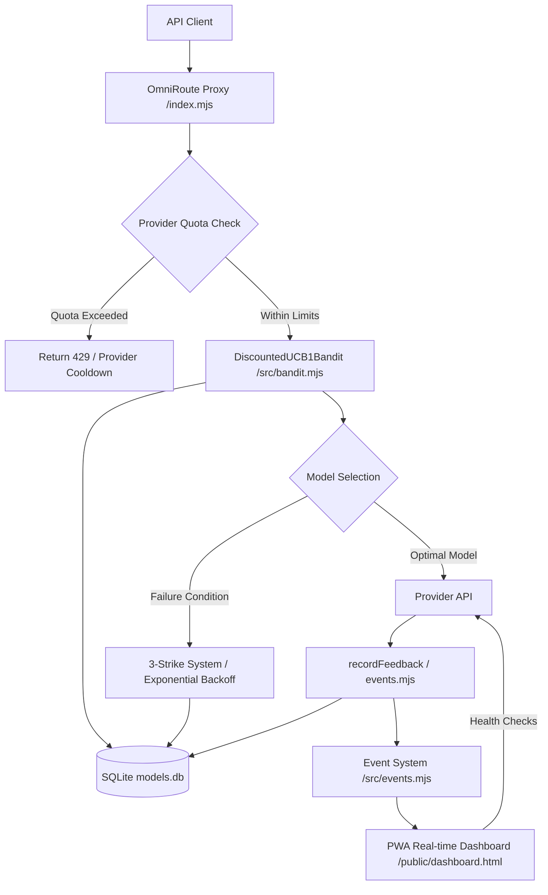

# OmniRoute Bandit Proxy

> A specialized proxy server for intelligent model routing, employing a multi-armed bandit algorithm to optimize request distribution while managing provider health, quotas, and failures.

---

## Table of Contents

- [Overview](#overview)
- [System Architecture](#system-architecture)
- [Getting Started](#getting-started)
  - [Prerequisites](#prerequisites)
  - [Installation](#installation)
  - [Configuration](#configuration)
- [Usage](#usage)
- [Core Features](#core-features)
- [Repository Structure](#repository-structure)
- [Operations & Maintenance](#operations--maintenance)
- [Testing](#testing)
- [Contributing](#contributing)
- [License](#license)

---

## Overview

OmniRoute Bandit Proxy is a production-grade middleware layer that sits between client applications and LLM provider APIs. It leverages the `DiscountedUCB1Bandit` algorithm—an Upper Confidence Bound variant with exponential discounting—to dynamically route requests to the best-performing models while ensuring high availability, cost control, and graceful degradation under failure conditions.

The proxy manages provider-level quotas, implements an aggressive 3-strike punishment system for critical failures, and provides a real-time Progressive Web App (PWA) dashboard for monitoring model health, bans, cooldowns, and request metrics.

---

## System Architecture

### High-Level Data Flow



### Decision Pipeline

1. **Request Reception**: The Express proxy (`src/index.mjs`) receives incoming requests and extracts model capabilities, tool requirements, and image-generation flags from the payload.

2. **Quota Validation**: Provider-level quotas are checked atomically for minute and day windows. Exceeded quotas trigger provider cooldowns without UCB1 evaluation, returning appropriate error responses.

3. **Bandit Evaluation**: The `DiscountedUCB1Bandit` engine scores available models using Upper Confidence Bound with 0.99 exponential discounting per event. A 30-second rank cache (`_rankCache`) optimizes repeated selections and maintains model ranking order.

4. **Capability Filtering**: Models are filtered based on:
   - Chat-only vs. tool-capable vs. image-generation support
   - Dynamic token limits extracted from 413 ITPM errors
   - Permanent bans and cooldown status from the database
   - `EXCLUDE_THINKING` and `EXPLOIT_ONLY` mode flags

5. **Failure Classification**: Errors are classified into 5 scopes:
   - **Ban**: Model permanently disabled (e.g., 400 capability mismatch, permanent=1)
   - **Cooldown**: Temporary model exclusion (e.g., 5xx errors, 429 quota exceeded)
   - **Flag**: Provider attention flag set (e.g., needs_attention)
   - **Degraded**: Score multiplied by 0.3 for models with 5xx history
   - **Transient**: Timeouts reclassified as cooldowns, not critical failures

6. **Feedback Loop**: `recordFeedback()` synchronizes `models` and `provider_history` tables, updates ban/cooldown flags, records `consecutive_critical_failures` and `consecutive_5xx` counters, and emits real-time events to the dashboard.

### Failure Governance Architecture

- **3-Strike System**: Three consecutive critical failures (403 Forbidden, 429 Rate Limit, safeWrite errors) result in a permanent ban of the affected model. The `consecutive_critical_failures` counter tracks the streak and resets on any successful request.

- **Exponential Backoff**: Cooldowns escalate in the following order for repeated transient failures: 15s → 5m → 30m → 2h → permanent. The `consecutive_5xx` counter triggers degraded mode when the threshold is exceeded.

- **Emergency Relaxation**: Respects active cooldowns; consecutive failure counters reset on any successful request, preventing permanent bans from transient error spikes.

- **Soft Bias**: Stackable `profileMultiplier` values from `config/bandit.json` apply to UCB1 scores for preference-based routing without affecting the core algorithm.

- **Unified History**: The `models` and `provider_history` tables remain synchronized on all ban/cooldown events via `recordFeedback()`. Model bans update `provider_history.needs_attention` and `provider_history.permanent`; model cooldowns update `provider_history.cooldown_until`.

### Error Pattern Classification

```
config/bandit.json error mapping:
  - safeWrite / cannot access safeWrite / safeWrite before initialization / safeWrite is not initialized
    → ban-model (critical failure → 3-strike counter)
  - 403 Key limit exceeded → cooldown-provider with reset time
  - 5xx errors → transient (cooldown-model), NOT critical
  - 429 Rate limit → critical failure (3-strike)
  - Timeout → transient (cooldown-model), NOT critical
```

### Session Management

- **Session TTL**: 30 minutes (`SESSION_TTL_MS`)
- **Stream Idle**: 60 seconds (`STREAM_IDLE_MS`), reset on any chunk or heartbeat
- **Session Affinity**: Blacklisted on model errors and failures; invalidated when `consecutive_critical_failures` threshold is crossed

---

## Getting Started

### Prerequisites

- **Node.js** (v18+ recommended)
- **npm** or **yarn** package manager
- **SQLite** (via `better-sqlite3` native binding)
- **Git**

### Installation

1. Clone the repository:

   ```bash
   git clone https://github.com/CherrugDeveloper/omniroute-bandit-proxy.git
   cd omniroute-bandit-proxy
   ```

2. Install dependencies:

   ```bash
   npm install
   ```

3. Create the environment file from the example:

   ```bash
   cp .env.example .env
   ```

4. Review and edit `.env` with your provider API keys, proxy ports, and operational thresholds.

5. Start the proxy:

   ```bash
   npm start
   ```

   For development with watch mode:

   ```bash
   npm run dev
   ```

---

## Configuration

### Environment Variables (`.env`)

| Variable | Description | Default |
|----------|-------------|---------|
| `PORT` | HTTP server port | `8080` |
| `API_TOKEN` | Authentication token for dashboard and control API | `""` |
| `SESSION_TTL_MS` | Session lifetime in milliseconds | `1800000` (30m) |
| `STREAM_IDLE_MS` | Stream idle timeout in milliseconds | `60000` (60s) |

### Bandit Configuration (`config/bandit.json`)

The `config/bandit.json` file controls:

- **Error Classification**: Maps error patterns to ban/cooldown/flag scopes
- **Fallback Chain**: Defines provider failover order (bypasses UCB1 when enabled)
- **Soft Bias**: `profileMultiplier` values that stack to adjust UCB1 scores
- **Critical Failures**: Patterns triggering the 3-strike permanent ban system
- **Degraded Mode**: Score multiplier (0.3) for models with persistent 5xx history
- **Cooldown Configuration**: Exponential backoff tiers (15s → 5m → 30m → 2h → permanent)

### Provider Limits (`config/provider-limits.json`)

Defines provider-specific quotas, ITPM (Input Tokens Per Minute) limits, and model capability mappings including:
- `is_paid` detection for free vs. paid model routing
- `catalogRawCount` for accurate model counts
- ITPM-based dynamic_max_tokens estimation
- `EXCLUDE_THINKING`, `EXPLOIT_ONLY` mode routing flags

---

## Usage

### Start the Server

```bash
# Production
npm start

# Development (watch mode)
npm run dev
```

### API Endpoints

| Endpoint | Method | Description |
|----------|--------|-------------|
| `/v1/chat/completions` | POST | Route chat completion requests via bandit algorithm |
| `/v1/images/generations` | POST | Route image generation requests |
| `/v1/models` | GET | List available models with health status |
| `/v1/metrics` | GET | Retrieve proxy metrics (active models, bans, cooldowns) |
| `/v1/changelog` | GET | Get changelog history |

### Dashboard

Access the real-time monitoring dashboard at `http://localhost:8080`. The PWA dashboard provides:

- Model health status and permanent/cooldown ban tracking
- Provider quota and cooldown monitoring with countdown timers
- Real-time log streaming with filtering by event type
- Request success rate and average latency metrics per model
- Training daemon control and status display
- Unified history and selection timeline visualization

---

## Core Features

### Bandit Routing Engine

- **Algorithm**: `DiscountedUCB1Bandit` with 0.99 discount per event
- **Rank Cache**: 30-second TTL for model ranking (`_rankCache`)
- **Soft Bias**: Stackable `profileMultiplier` applied to UCB1 scores for preference-based routing
- **Training Table**: Isolated `models_train` table; production reads `models` + `0.3 * models_train` (if `N < 1`)
- **Free/Paid Detection**: Automatic classification with `ONLY_FREE`/`EXCLUDE_PAID` filters
- **Dynamic Token Limits**: Self-learning token estimation from 413 ITPM errors

### Failure Governance

- **Classification Scopes**: Ban, cooldown, flag, and degraded modes
- **3-Strike System**: Permanent ban after 3 consecutive critical failures (403, 429, safeWrite errors)
- **Exponential Backoff**: Cooldowns escalate 15s → 5m → 30m → 2h → permanent
- **Emergency Relaxation**: Respects cooldowns; consecutive fails reset on success
- **Error Pattern Mapping**: `config/bandit.json` maps safeWrite errors to ban-model

### Quota Management

- **Scope**: Provider-level (not model-level)
- **Windows**: Atomic checks for minute and day quota windows
- **Tracking**: `total_failures` and `consecutive_5xx` counters
- **429 Handling**: Critical failure (3-strike) for provider-level quotas; cooldown-only for model-level

### Proxy & Sessions

- **Session TTL**: 30 minutes
- **Stream Idle**: 60 seconds (reset on any chunk or heartbeat)
- **SPA Fallback**: Server-side fallbacks for non-API routes
- **Provider Health Tracking**: Exponential cooldown with n+1 rotation pointer

---

## Repository Structure

```text
omniroute-bandit-proxy/
├── CHANGELOG.md              # Version history (Keep a Changelog format)
├── README.md                 # Project documentation
├── AGENTS.md                 # AI agent technical guidelines
├── package.json              # Node.js project manifest
├── .env.example              # Environment variable template
├── config/                   # Configuration files
│   ├── bandit.json           # Bandit algorithm & error classification
│   ├── modes.json            # Mode definitions
│   ├── provider-limits.json  # Provider quotas & limits
│   └── ...
├── src/                      # Source code
│   ├── index.mjs             # Express proxy entry point
│   ├── bandit.mjs            # DiscountedUCB1Bandit engine
│   ├── events.mjs            # Event system for real-time updates
│   ├── provider-quota.mjs    # Provider quota enforcement
│   ├── request-tracker.mjs   # Request history & metrics
│   ├── health-check.mjs      # Provider health check middleware
│   └── ...
├── scripts/                  # Maintenance & automation scripts
├── public/                   # PWA dashboard assets
│   ├── dashboard.html        # Real-time monitoring UI
│   ├── manifest.json         # PWA manifest
│   └── sw.js                 # Service worker
├── __tests__/                # Test suite (node:test + in-memory DB)
├── docs/                     # Technical documentation
└── plans/                    # Architectural planning documents
```

---

## Operations & Maintenance

### Systemd Service

The project includes `omniroute-bandit-proxy.service` for systemd-based deployment:

```bash
sudo systemctl start omniroute-bandit-proxy
sudo systemctl status omniroute-bandit-proxy
sudo systemctl logs -f omniroute-bandit-proxy
```

### Maintenance Scripts

| Script | Purpose |
|--------|---------|
| `scripts/restart-safe.sh` | Safe service restart with port conflict resolution and failed state reset |
| `scripts/reset-bans.mjs` | Reset model/provider bans and cooldown flags in the database |
| `scripts/inspect-db.mjs` | Inspect SQLite database state, model status, and ban/cooldown flags |
| `scripts/fix-db.mjs` | Database repair utility for schema issues and flag corrections |
| `scripts/train-daemon.mjs` | Training daemon control with start/stop/status/logs |
| `scripts/clear-all-attention.mjs` | Clear all provider attention flags |
| `scripts/check-bans.mjs` | Check current ban status and statistics |
| `scripts/inspect-bans.mjs` | Detailed ban inspection with reasoning |
| `scripts/debug-request-logs.mjs` | Debug request logging and session tracking |
| `scripts/inspect-summary.mjs` | Summary inspection of database state |

### Health Checks

The proxy performs provider health checks with configurable frequency. Failed providers are moved to cooldown or banned based on the error classification rules in `config/bandit.json`. Health check results update the model ranking cache and affect subsequent selection decisions.

### Ban/Cooldown Recovery

- **Temporary Cooldowns**: Models automatically return to active status after the cooldown period expires
- **Permanent Bans**: Require manual reset via `scripts/reset-bans.mjs` or `scripts/clear-all-attention.mjs`
- **Cooldown Tracking**: `provider_history.cooldown_until` stores the expiration timestamp
- **Attention Flags**: `provider_history.needs_attention` marks providers requiring manual review

---

## Testing

The project uses `node:test` with an in-memory `:memory:` SQLite database for test isolation.

```bash
# Run all tests
npm run test

# Syntax check all source files
npm run check
```

### Test Coverage

- **Bandit Configuration**: Model selection, ranking, and UCB1 score calculation
- **Provider Quota Enforcement**: Minute and day window atomic checks
- **Punishment System**: 3-strike logic, exponential backoff, and emergency relaxation
- **Request Tracking**: Metrics aggregation and dashboard data accuracy
- **Training Feedback**: Model status updates and cooldown flag management

### Test Configuration

Tests use an in-memory SQLite database (`:memory:`) to ensure:
- No persistent data changes between test runs
- Full isolation from production database state
- Rapid test execution without external dependencies

---

## Contributing

1. Fork the repository
2. Create a feature branch (`git checkout -b feat/your-feature`)
3. Commit changes using conventional commit format: `type(scope): subject`
4. Push to the branch (`git push origin feat/your-feature`)
5. Open a Pull Request

### Commit Convention

- `feat`: New feature
- `fix`: Bug fix
- `docs`: Documentation changes
- `style`: Formatting, missing semicolons, etc.
- `refactor`: Code change that neither fixes a bug nor adds a feature
- `test`: Adding missing tests or correcting existing tests
- `chore`: Build process or auxiliary tool changes

### Development Workflow

```bash
# Install dependencies
npm install

# Run syntax check
npm run check

# Run test suite
npm run test

# Start development server
npm run dev

# Generate changelog entries (manual review required)
# Refer to CHANGELOG.md Keep a Changelog format
```

---

## License

MIT License. See [`LICENSE`](LICENSE) for details.

---

## References

- [Keep a Changelog](https://keepachangelog.com/en/1.0.0/)
- [Semantic Versioning](https://semver.org/spec/v2.0.0.html)
- [Discounted UCB1 Bandit Algorithm](https://www.cs.ucsb.edu/~ligang/teaching/fall19/cs295/reading/bandit.pdf)
- [Utrecht University - README conventions](https://utrechtuniversity.github.io/workshop-computational-reproducibility/chapters/readme-files.html)
- [better-sqlite3 Documentation](https://github.com/JoshuaWise/better-sqlite3)
- [Express.js Guide](https://expressjs.com/en/guide/routing.html)
