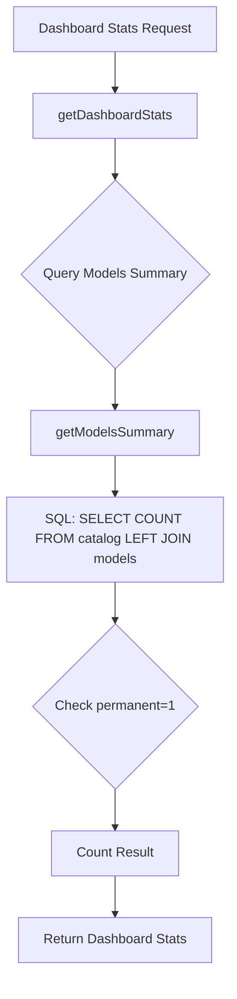

# Plan: Fix Ban Metrics Discrepancy

## Problem
The dashboard reports an unusually high number of permanently banned models (1124/1173).

## Proposed Steps

1.  **Diagnostic Verification**:
    - Run a script to query the database and count exact number of `permanent=1` entries in `models` table.
    - Compare this with `catalog` table size to ensure the `getModelsSummary` SQL query is not performing unintended Cartesian products or filtering incorrectly.

2.  **Punishment Logic Review**:
    - Analyze `src/bandit.mjs` for `recordPunishmentEvent` and the "3-strike" system implementation.
    - Confirm under what conditions `permanent` is set to `1`.

3.  **Implementation**:
    - Update `getModelsSummary` SQL query in `src/bandit.mjs` if it's over-counting.
    - If the database is filled with erroneous bans, create a migration or cleanup script to reset `permanent=0` for models that do not meet the 3-strike criteria.

## Mermaid Diagram

