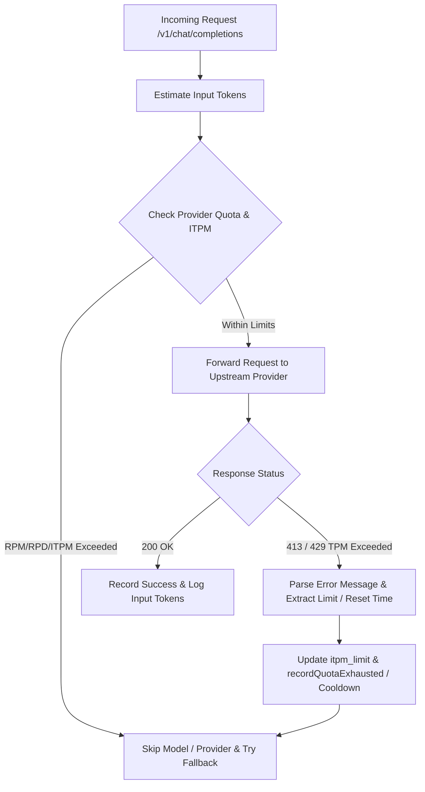

# Architectural Design: ITPM (Input Tokens Per Minute) Tracking & Enforcement

## 1. Overview & Problem Statement
Currently, the OmniRoute Bandit Proxy tracks Request Per Minute (RPM) and Requests Per Day (RPD) in [`src/provider-quota.mjs`](src/provider-quota.mjs:1). However, LLM providers enforce strict **Input Tokens Per Minute (ITPM)** / **Tokens Per Minute (TPM)** limits (e.g., a limit of 7000 tokens per minute when 7861 input tokens are requested). 

When a request exceeds ITPM, providers return status `413 Payload Too Large` or `429 Rate Limit` with messages containing dynamic limit values (e.g., `Requested 7861, Limit 7000`). Currently, the proxy reacts reactively via error classification (`_classifyError` in [`src/bandit.mjs`](src/bandit.mjs:1)) and session blacklisting, but lacks proactive rolling window ITPM tracking and precise extraction of provider-enforced token limits.

---

## 2. Proposed Architecture & Data Flow

### A. Database Schema Enhancements (`_migrateDB` in [`src/bandit.mjs`](src/bandit.mjs:1))
Extend `provider_history` (and optionally `models`) with ITPM tracking columns:
- `itpm_limit INTEGER DEFAULT 0` (configured limit or dynamically learned from error messages)
- `tokens_last_minute INTEGER DEFAULT 0` (rolling 60-second window counter for input tokens)
- `tokens_minute_started REAL DEFAULT 0` (timestamp when the current token window started)
- `itpm_resets_at REAL DEFAULT 0` (cooldown timestamp when ITPM quota resets)

### B. Configuration Updates (`config/provider-limits.json`)
Add `itpm` field alongside `rpm` and `rpd` for each provider:
```json
{
  "providers": {
    "groq": {
      "rpm": 50,
      "rpd": 500,
      "itpm": 7000
    },
    "openrouter": {
      "rpm": 100,
      "rpd": 1000,
      "itpm": 50000
    }
  }
}
```

### C. Enhanced Error Parsing & Limit Extraction (`_classifyError` in [`src/bandit.mjs`](src/bandit.mjs:1))
When an upstream error occurs (status 413 or 429 containing TPM / token limit messages):
1. Parse error messages matching patterns like:
   - `Requested (\d+).*Limit (\d+)` or `Limit (\d+).*Requested (\d+)`
   - `reset after (\d+)(s|m|h)`
2. Extract the exact token limit (e.g. `7000`) and dynamically update `itpm_limit` in `provider_history` (or model history).
3. Record quota exhaustion or model cooldown with calculated `retryAfter` duration.

### D. Proactive ITPM Enforcement (`canCall` & `recordCall` in [`src/provider-quota.mjs`](src/provider-quota.mjs:1))
1. **Window Roll**: In `_rollWindows(provider)`, check if 60 seconds have elapsed since `tokens_minute_started`. If so, reset `tokens_last_minute = 0` and update `tokens_minute_started = now`.
2. **Pre-check (`canCall(provider, estimatedTokens)`)**:
   - Check if `itpm_resets_at > now`.
   - Check if `tokens_last_minute + estimatedTokens > itpm_limit`. If exceeded, reject/skip proactively before sending the request.
3. **Recording (`recordCall(provider, estimatedTokens)`)**:
   - Increment `tokens_last_minute += estimatedTokens`.

---

## 3. Workflow Diagram



---

## 4. Implementation Plan Steps
1. Update `config/provider-limits.json` to include default `itpm` limits for providers.
2. Update [`src/provider-quota.mjs`](src/provider-quota.mjs:1) to add `itpm` rolling window tracking, `canCall(provider, estimatedTokens)`, and `recordCall(provider, estimatedTokens)`.
3. Update `_migrateDB` in [`src/bandit.mjs`](src/bandit.mjs:1) to add `itpm_limit`, `tokens_last_minute`, `tokens_minute_started`, and `itpm_resets_at` columns to `provider_history`.
4. Enhance `_classifyError` in [`src/bandit.mjs`](src/bandit.mjs:1) to parse exact limits and reset durations from 413/429 error messages.
5. Integrate ITPM checks into the request retry loop in [`src/index.mjs`](src/index.mjs:1).
