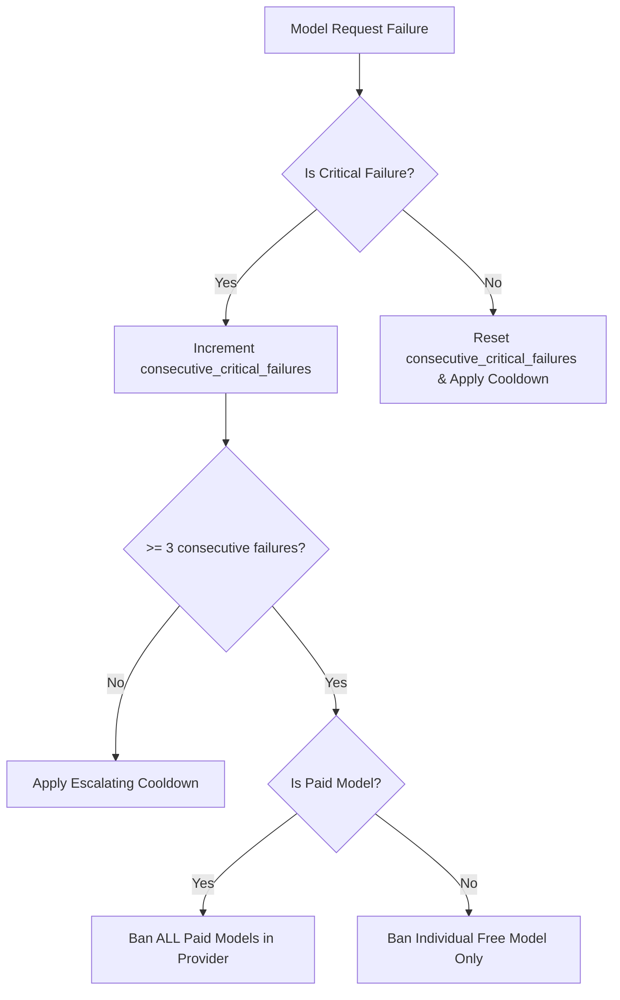

# Plan: Paid Model Group Punishment Architecture & Implementation

## Overview
For each provider, models are divided into two distinct groupings: free models (`is_paid = 0`) and paid models (`is_paid = 1`). When a critical failure occurs in one group, the penalization is isolated strictly to that specific group, without penalizing the entire provider or the other group.

## Architecture & Database Design
1. **Model Table Schema (`models`)**:
   - Includes `is_paid INTEGER DEFAULT 0` column.
   - Includes `consecutive_critical_failures` tracking per model.
   - Includes `permanent` ban flag.

2. **Penalty Isolation Logic**:
   - **Paid Models Group (`is_paid = 1`)**: When any paid model under a provider hits 3 consecutive critical failures (3-strike rule), all paid models (`WHERE provider = ? AND is_paid = 1`) for that provider receive a permanent ban. Free models under the same provider remain active and unaffected.
   - **Free Models Group (`is_paid = 0`)**: When a free model hits 3 consecutive critical failures, only that specific individual model is permanently banned (`WHERE id = ?`), leaving other free models and all paid models unaffected.

3. **Testing Suite**:
   - Located in [`__tests__/paid-model-group-punishment.test.js`](__tests__/paid-model-group-punishment.test.js).
   - Validates independent failure tracking, group-wide paid bans, and individual-level free model bans.

## Mermaid Workflow Diagram

