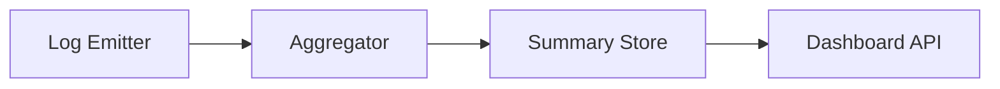

# Punishment System & Dashboard Optimization Plan

## Synthesis
The punishment mechanism is technically sound, utilizing exponential backoff and a 3-strike critical failure system, with permanent bans triggered at 10 failures. The dashboard latency observed is caused by the overhead of parsing/buffering up to 5000 log entries on the API path.

## Proposed Plan
1. **Log Aggregation:** Move away from scanning the full 5000-entry log buffer on the dashboard API path. Implement an asynchronous log aggregator that pre-calculates summary metrics and stores them in a memory-efficient structure.
2. **Dashboard API Optimization:** Refactor `/v1/dashboard/stats` to query the new aggregated summary store instead of parsing logs.
3. **Punishment Visibility:** Enrich the dashboard data by directly querying the `provider_history` table for the most recent `punishment_log` entries to explain the *reason* for bans more clearly.

## Architecture

