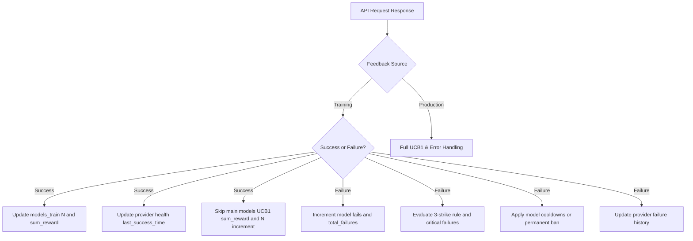

# Plan: Training Feedback Metrics & Punishment Refinement

## Overview
Refine how training feedback (`x-source: training`) is processed in `src/bandit.mjs`. 
- **Training Success**: Update `models_train` and provider health (`last_success_time`, resetting provider failure counters) without polluting or falsifying production UCB1 scoring (`sum_reward` and `N` in the main `models` table) since training calls are trivial.
- **Training Failure**: Fully apply all failure metrics, escalation, 3-strike rule, critical failure tracking, model cooldowns, permanent bans, and provider failure tracking so that problematic models encountered during training are rigorously punished.

## Proposed Architecture / Workflow

## Actionable Steps

- [ ] Modify `src/bandit.mjs` feedback handling for `source === 'training'` on success:
  - Keep `_recordTrainingFeedback` updating `models_train`.
  - Update provider health (`last_success_time`, clear consecutive provider failures).
  - Bypass updating production UCB1 `sum_reward` and `N` in the main `models` table for training successes.
- [ ] Ensure training failures (`source === 'training'` and `success === false`) execute full error classification, model failure increments, 3-strike rule punishment, cooldowns, bans, and provider error tracking.
- [ ] Add unit tests in `__tests__/` (or update existing bandit tests) to verify that training successes do not corrupt production UCB1 scores while training failures correctly punish problematic models and update provider health metrics.
- [ ] Run test suite (`npm test`) and check (`npm run check`) to validate functionality.
